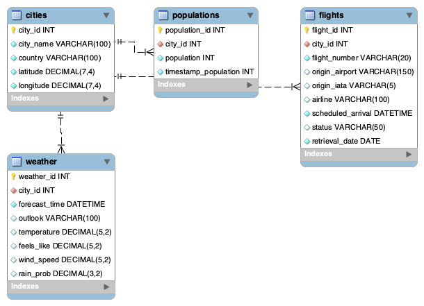

# Gans ETL Pipeline: Data for Predicting E-Scooter Movement

An end-to-end ETL (Extract, Transform, Load) pipeline that collects city, weather and flight data from external sources and stores it in a MySQL database. Built for **Gans**, an e-scooter-sharing startup, to support future predictive modelling of where scooters are needed.

> **Status:** Complete (core pipeline) | **Built with:** Python, BeautifulSoup, pandas, SQLAlchemy, MySQL

---

## Table of Contents
1. [Business Problem](#business-problem)
2. [Project Overview](#project-overview)
3. [Data Sources](#data-sources)
4. [Database Design](#database-design)
5. [Repository Structure](#repository-structure)
6. [Setup and Usage](#setup-and-usage)
7. [Challenges and Solutions](#challenges-and-solutions)
8. [Key Insights and Tips](#key-insights-and-tips)
9. [Skills Demonstrated](#skills-demonstrated)
10. [Possible Next Steps](#possible-next-steps)

---

## Business Problem

Gans operates e-scooters that users rent by the minute. Its success depends on having scooters **parked where users need them**. Several factors create imbalances:

- Hilly terrain (users ride uphill, walk downhill)
- Morning commutes from residential areas to the city centre
- Rain, which sharply reduces usage
- Tourists arriving by air who need scooters downtown or near landmarks

Before building predictive models, Gans needs data. This project collects external data that could help anticipate scooter movement and stores it in a structured, queryable form.

## Project Overview

The pipeline is built locally and follows the ETL pattern:

| Stage | What happens |
|-------|--------------|
| **Extract** | Scrape city data from Wikipedia; pull weather forecasts and flight arrivals from APIs |
| **Transform** | Clean and structure the data with pandas (string methods, regex, type conversion) |
| **Load** | Write the data into a relational MySQL database with proper keys and constraints |

Running `python main.py` executes the whole pipeline: it scrapes the cities, fetches the weather forecast and tomorrow's flight arrivals, and loads everything into MySQL. The loading is safe to rerun: populations and flights that already exist are skipped, and weather forecasts are updated in place, so no duplicates are created.

## Data Sources

### 1. Web scraping: city demographics (Wikipedia)
- **Tool:** `requests` + `BeautifulSoup`
- **Cities:** Berlin, Hamburg, Munich
- **Fields:** population, latitude, longitude, country
- **Transform notes:**
  - Population: removed thousands separators and footnote markers with regex (`3,596,999` becomes the integer `3596999`)
  - Coordinates: converted degrees/minutes/seconds (`52°31′12″N`) to decimal degrees (`52.52`), with S and W as negative values
  - Infobox values are found by their row label (e.g. "Population", "Country") through one helper function instead of hardcoded positions
  - The scraper is a reusable function (`get_cities_data`) that takes a list of cities and returns a clean DataFrame; a failing page is skipped instead of stopping the run

### 2. Weather: OpenWeather API
- **Endpoint:** 5-day / 3-hour forecast (`/data/2.5/forecast`), queried by the latitude and longitude stored in the `cities` table
- **Fields:** forecast time, outlook, temperature, feels-like, wind speed, rain probability
- **Transform notes:**
  - Selected the useful fields from the nested JSON response and flattened them into one row per city and forecast time
  - Requested metric units; converted timestamps to `datetime`
  - Forecast times are in **UTC**, as returned by the API
  - About 40 forecast rows per city (5 days at 3-hour steps)

### 3. Flights: AeroDataBox API (via RapidAPI)
- **Endpoint:** `/flights/airports/iata/{airport code}/{from}/{to}` with `direction=Arrival`
- **Fields:** flight number, origin airport (name and IATA code), airline, scheduled arrival, status, retrieval date
- **Transform notes:**
  - Tomorrow's date is generated automatically and formatted to the endpoint's requirements
  - The endpoint accepts at most a 12-hour time window, so each airport is queried twice (00:00-11:59 and 12:00-23:59)
  - Nested JSON flattened; rows without a flight number or arrival time are dropped, and duplicates removed
  - Scheduled arrival times are **local airport time** (timezone offset removed)

## Database Design



`cities` is the central table. All other tables reference it through `city_id`, so every record is linked to an existing city.

| Table | Purpose | Key columns |
|-------|---------|-------------|
| `cities` | Static list of cities with their location | `city_id` (PK), `city_name` (unique), `country`, `latitude`, `longitude` |
| `populations` | Population over time, one row per city per year (history is kept, not overwritten) | `population_id` (PK), `city_id` (FK), `population`, `timestamp_population` |
| `weather` | Forecast data per city and forecast time | `weather_id` (PK), `city_id` (FK), `forecast_time`, `outlook`, `temperature`, `feels_like`, `wind_speed`, `rain_prob` |
| `flights` | Tomorrow's arrivals per airport | `flight_id` (PK), `city_id` (FK), `flight_number`, `origin_airport`, `origin_iata`, `airline`, `scheduled_arrival`, `status`, `retrieval_date` |

**Design choices**
- Primary keys on every table, foreign keys to `cities`, and `NOT NULL` on the columns that must always be filled
- `UNIQUE` constraints (`city_id` + year, `city_id` + forecast time, `city_id` + flight number + arrival time) prevent duplicates when the pipeline is rerun
- Appropriate data types: `DECIMAL` for coordinates and weather values, `DATETIME` for times, `VARCHAR` for text
- The full schema is in [`sql/schema.sql`](sql/schema.sql)

## Repository Structure

```
gans-etl-pipeline/
├── README.md
├── requirements.txt
├── .gitignore
├── .env.example          # template for API keys and DB credentials
├── main.py               # runs the full pipeline
├── notebooks/
│   ├── 01_web_scraping.ipynb
│   ├── 02_weather_api.ipynb
│   ├── 03_flights_api.ipynb
│   └── 04_database_load.ipynb
├── src/
│   ├── config.py         # loads credentials from environment variables
│   ├── scraping.py       # Wikipedia scraper
│   ├── weather.py        # OpenWeather extraction and cleaning
│   ├── flights.py        # AeroDataBox extraction and cleaning
│   └── database.py       # connection and loading functions
├── sql/
│   └── schema.sql        # CREATE TABLE statements
└── docs/
    └── er_diagram.png
```

The notebooks document the exploration of each data source. The `src/` modules contain the final, reusable functions, and `main.py` ties them together.

## Setup and Usage

**Prerequisites:** Python 3.x, MySQL server running locally, an [OpenWeather](https://openweathermap.org/api) API key, and a [RapidAPI](https://rapidapi.com/) key with access to AeroDataBox.

```bash
# 1. Clone the repo
git clone https://github.com/instrumentofdarkness/gans-etl-pipeline.git
cd gans-etl-pipeline

# 2. Create and activate a virtual environment
python3 -m venv .venv
source .venv/bin/activate

# 3. Install dependencies
pip install -r requirements.txt

# 4. Add your credentials
cp .env.example .env
# then edit .env with your own API keys and MySQL user/password

# 5. Create the database and tables
mysql -u <user> -p < sql/schema.sql

# 6. Run the pipeline
python main.py
```

Credentials are read from environment variables (via `python-dotenv`), and `.env` is excluded from version control.

## Challenges and Solutions

- **Challenge:** Wikipedia infoboxes can list several population figures (city, urban area, metro area), and the position of the right row is not guaranteed.
  **Solution:** Searched the infobox by its row label instead of a fixed position, and checked the results for all three cities against the real figures.
- **Challenge:** Coordinates on Wikipedia come in degrees, minutes and seconds, and sometimes without seconds.
  **Solution:** Wrote a regex-based converter with optional minutes and seconds that returns rounded decimal degrees and handles southern and western hemispheres.
- **Challenge:** The database connection failed with "Access denied" because the `.env` file still contained placeholder credentials.
  **Solution:** Entered the real MySQL credentials and restarted the notebook kernel, since the variables are only read when the config module is first imported.
- **Challenge:** Loading weather data failed because the `weather` table did not exist yet.
  **Solution:** Created the table from the schema file first. The schema script is now the single place where all tables are defined, so the database can be rebuilt from scratch.
- **Challenge:** The flights endpoint only returns a 12-hour window per request, and the response is deeply nested.
  **Solution:** Split each day into two requests per airport and flattened the nested fields into one clean row per flight.
- **Challenge:** Rerunning the pipeline could insert the same data twice.
  **Solution:** Added unique constraints and used insert-or-ignore and upsert statements, so every load can be repeated safely.

## Key Insights and Tips

- Inspect the raw response (HTML or JSON) before writing any parsing code, and test your code on every page or endpoint you plan to use, not just the first one.
- Keep API keys and database passwords in a git-ignored `.env` file, and commit an `.env.example` template instead.
- Plan the database schema before loading data, and use unique constraints so the pipeline can be rerun without creating duplicates.
- Store time zones consciously: here the weather is in UTC and flight times are local, which matters when the two are joined later.
- Build small, reusable functions first (one per source), then combine them in a single script.

## Skills Demonstrated

- Web scraping with BeautifulSoup
- Consuming REST APIs and navigating JSON
- Data cleaning with pandas string methods and regex
- Loops, list comprehensions and reusable functions in Python
- Designing a relational data model (tables, relationships)
- MySQL tables with appropriate data types, constraints, primary and foreign keys
- Loading data from Python into MySQL (SQLAlchemy and INSERT queries)
- Documenting a project for a portfolio

## Possible Next Steps

- Scrape and add cities outside Germany, including cities in the southern and western hemispheres
- Schedule the pipeline to run daily so weather forecasts and flight arrivals build up over time
- Join the weather, flight and population tables to look for patterns that could predict scooter demand
- Build a first predictive model on the collected data
